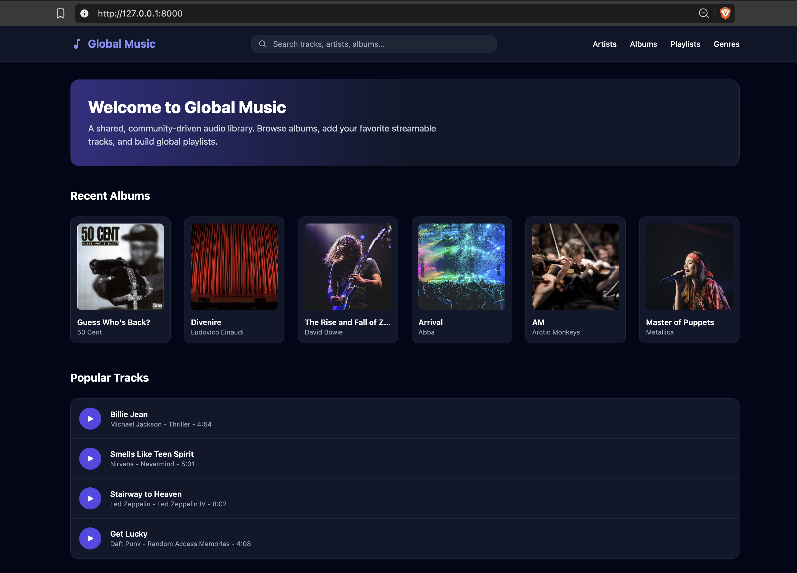
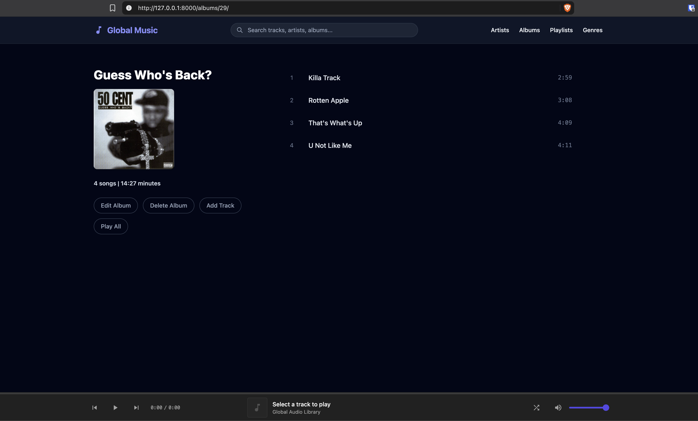
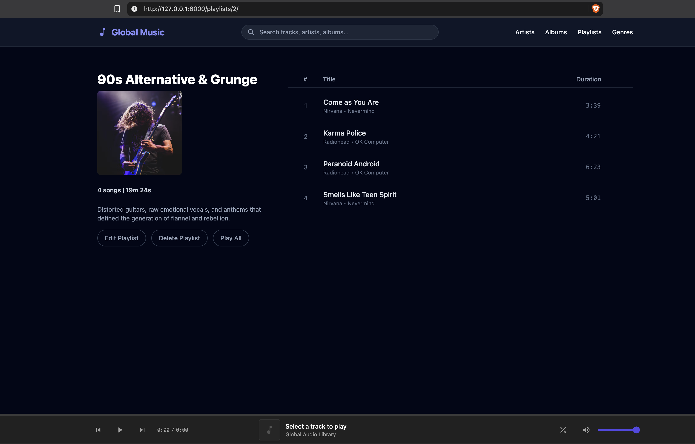
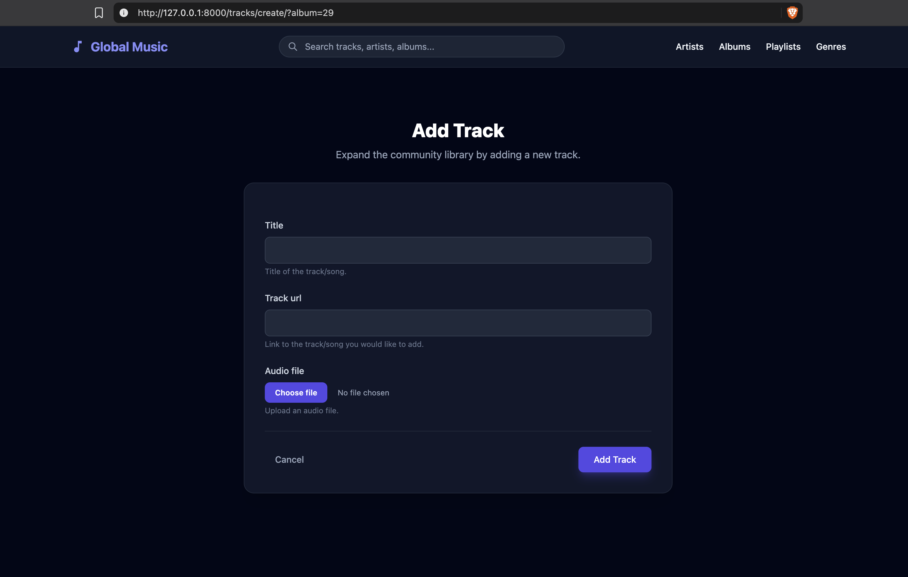
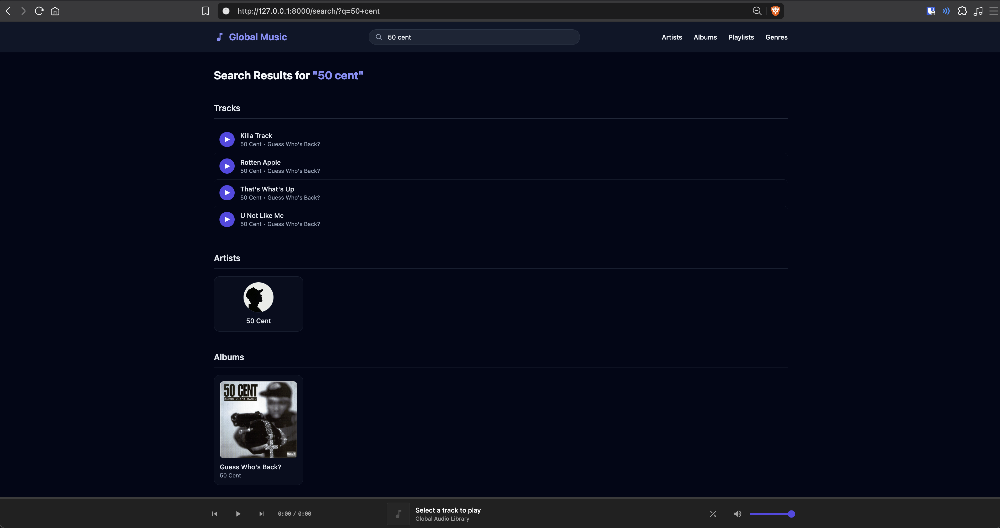

# Global Music

Global Music is a Django application for a community/shared music library. 
Users can manage tracks, albums, artists, and genres without having to create an account.

## Table of Contents
- [Features](#features)
- [Screenshots](#screenshots)
- [Technology](#technology)
- [AI Assistance](#ai-assistance)
- [Installation](#installation)
- [Configuration](#configuration)
- [Starting with an Empty Library](#starting-with-an-empty-library)
- [Audio Sources](#audio-sources)
- [Project Structure](#project-structure)
- [Database Relationships](#database-relationships)

## Features

- Create, browse, edit, and delete artists, albums, and playlists.
- Create genres and browse artists by genre.
- Add tracks to albums via URL or by uploading a file.
- Remove tracks from albums or playlists.
- Search for artists, albums, and tracks.
- Browse recent albums and popular tracks on the homepage.
- Shared audio player with play/stop, volume,
  shuffle, and previous/next controls.

## Screenshots

### Home Page


### Album Details


### Playlist Details


### Add Track


### Search Results


## Technology

- Python 3.14.3
- Django 6.1.1
- SQLite
- Mutagen for uploaded-audio metadata
- Tailwind CSS for styling
- Hotwire Turbo for navigation and persistent audio playback

## AI Assistance
AI tools were used to generate the HTML, CSS, and JS for the frontend of the project.

## Installation

Download or clone the repository and open a terminal in the directory
containing `manage.py`.

### 1. Create a virtual environment

```bash
python -m venv .venv
```

Linux/macOS venv activation:

```bash
source .venv/bin/activate
```

Windows venv activation:

```powershell
.\.venv\Scripts\Activate.ps1
```

### 2. Install dependencies

```bash
python -m pip install -r requirements.txt
```

### 3. Apply database migrations

```bash
python manage.py migrate
```

### 4. Start the development server

```bash
python manage.py runserver
```

Open: \
http://127.0.0.1:8000/

## Configuration

- Application data is stored in `db.sqlite3`.
- Uploaded audio is stored in `media/tracks/audio_files/`.

## Starting with an Empty Library

1. Open **Genres** and add a genre.
2. Open **Artists**, choose **Add Artist**, and select a genre.
3. Open **Albums**, choose **Add Album**, and select an artist.
4. Open the album details and choose **Add Track**.
5. Provide either an audio upload or a direct audio URL.
6. Open **Playlists**, create a playlist, and select existing tracks.

## Audio Sources

Supported file extensions are `.mp3`, `.wav`, `.flac`, `.aac`, `.m4a`.
Uploads are limited to 50 MB.
Only one audio source per track is supported, so either a URL or a file upload.
Direct URLs must point to audio files rather than streaming-service
web pages. 

The following websites provide some easy to access tracks:

- [SoundHelix Audio Examples](https://www.soundhelix.com/audio-examples) \
- [Internet Archive Audio Collection](https://archive.org/details/audio?tab=collection)

Uploaded-file duration is extracted using Mutagen. For direct URLs,
the browser attempts to read the duration from audio metadata.

## Project Structure

```text
catalog/       Genres, artists, albums, search, and custom filters
tracks/        Tracks, audio validation, uploads, and play counters
playlists/     Playlist management and track membership
musicPlayer/   Project settings, root URLs, home view, shared classes
templates/     Page templates
media/         Locally uploaded audio
```

## Database Relationships

- An artist can have multiple albums.
- An album can have multiple tracks.
- Artists and genres have a many-to-many relationship.
- Playlists and tracks have a many-to-many relationship.
